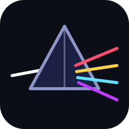
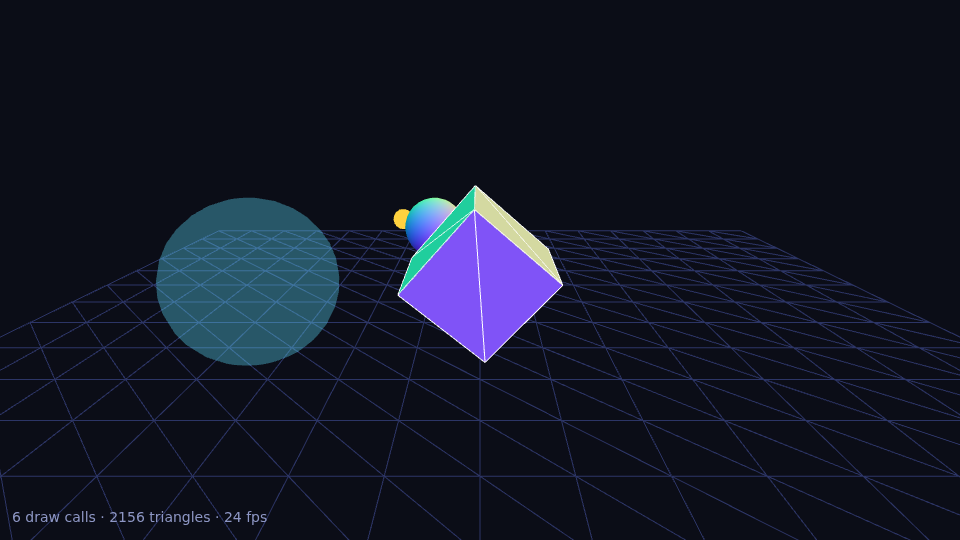

<p align="center">
  
</p>

<h1 align="center">Vertex</h1>

<p align="center">
  Engine rendering 3D JavaScript ringan yang dibuat dari nol di atas WebGL2.
</p>

<p align="center">
  
</p>

> **Status: pre-alpha (v0.3.0).** Alur inti berjalan dari ujung ke ujung: math, scene graph, kamera, geometry, material, lampu, texture, pemuat **OBJ + MTL**, dan `renderer.render(scene, camera)`.
> **Belum ada** shadow, specular, loader glTF, picking, maupun sistem animasi. Vertex **belum** sebanding fiturnya dengan engine matang seperti Three.js. Rincian lengkap ada di [PROGRESS.md](PROGRESS.md).

## Daftar isi

- [Kenapa Vertex](#kenapa-prismjs)
- [Instalasi](#instalasi)
- [Mulai cepat](#mulai-cepat)
- [CSS bantu](#css-bantu)
- [Aset](#aset)
- [Memuat model OBJ dan MTL](#memuat-model-obj-dan-mtl)
- [Ringkasan API](#ringkasan-api)
- [Contoh](#contoh)
- [Arsitektur](#arsitektur)
- [Dukungan browser](#dukungan-browser)
- [Pengembangan](#pengembangan)
- [Merilis ke GitHub dan jsDelivr](#merilis-ke-github-dan-jsdelivr)
- [Pemecahan masalah](#pemecahan-masalah)
- [Keterbatasan](#keterbatasan)
- [Lisensi](#lisensi)

## Kenapa Vertex

Engine kecil dengan arsitektur sendiri: API sederhana untuk pemula, titik perluasan yang jelas untuk yang sudah mahir, tanpa dependensi runtime, dan tanpa framework. Kodenya tidak membungkus atau menyalin engine 3D lain.

Prinsip: API sederhana, inti kecil, modular, kode mudah dibaca, dan mengutamakan browser.

## Instalasi

### Lewat CDN (jsDelivr)

Cara tercepat, tanpa bundler. Taruh CSS (opsional) di `<head>` dan JS sebelum skripmu:

```html
<link rel="stylesheet" href="https://cdn.jsdelivr.net/gh/JANUARPROGRAM/Vertex@v0.3.0/dist/vertex.css">
<script src="https://cdn.jsdelivr.net/gh/JANUARPROGRAM/Vertex@v0.3.0/dist/Vertex"></script>
```

Skrip itu membuat satu variabel global bernama `Prism` (misalnya `new Prism.Renderer(...)`).

File yang tersedia di rilis:

| File | Isi |
| --- | --- |
| `dist/Vertex` | Build global (IIFE), tidak diminify, mudah di-debug. Menyediakan `window.Prism`. |
| `dist/prism.min.js` | Sama seperti di atas, tetapi diminify (lebih kecil). |
| `dist/prism.module.js` | Build ES module, diminify. |
| `dist/vertex.css` | CSS bantu (opsional), lihat [CSS bantu](#css-bantu). |
| `dist/prism.min.css` | Versi CSS yang diminify. |
| `assets/nama-file` | Aset (gambar, nanti texture dan model), lihat [Aset](#aset). |

Ganti `@v0.3.0` dengan versi lain bila perlu. Untuk produksi, pakai tag versi yang tetap dan hindari `@main` karena isinya bisa berubah dan di-cache CDN.

### ES module lewat CDN

```html
<script type="module">
  import * as Prism from "https://cdn.jsdelivr.net/gh/JANUARPROGRAM/Vertex@v0.3.0/dist/prism.module.js";

  const renderer = new Prism.Renderer({ canvas: document.querySelector("canvas") });
</script>
```

### Dari source

Repo ini berisi ES module native, jadi bisa dipakai langsung tanpa build:

```bash
git clone https://github.com/JANUARPROGRAM/Vertex.git
cd Vertex
npm run dev        # server lokal di http://localhost:8080/ (tidak perlu npm install)
```

```js
import * as Prism from "./src/index.js";
```

Paket npm **belum** dipublikasikan.

## Mulai cepat

Satu file HTML lengkap yang menampilkan kubus berputar (jika dibuka dari repo ini, ganti URL CDN dengan `../../dist/Vertex` dan `../../dist/vertex.css`):

```html
<!DOCTYPE html>
<html lang="id">
<head>
  <meta charset="utf-8">
  <meta name="viewport" content="width=device-width, initial-scale=1">
  <title>Kubus Vertex</title>
  <link rel="stylesheet" href="https://cdn.jsdelivr.net/gh/JANUARPROGRAM/Vertex@v0.3.0/dist/vertex.css">
  <style>html, body { height: 100%; margin: 0; background: #0b0d17; }</style>
</head>
<body>
  <canvas id="canvas" class="prism-canvas prism-fullscreen"></canvas>
  <pre id="error" class="prism-error" hidden></pre>

  <script src="https://cdn.jsdelivr.net/gh/JANUARPROGRAM/Vertex@v0.3.0/dist/Vertex"></script>
  <script>
    try {
      const renderer = new Prism.Renderer({ canvas: document.getElementById("canvas") });

      const scene = new Prism.Scene();
      scene.background = new Prism.Color("#0b0d17");

      const camera = new Prism.PerspectiveCamera(60, 1, 0.1, 100);
      camera.position.z = 4;

      const cube = new Prism.Mesh(
        new Prism.BoxGeometry(1.4, 1.4, 1.4),
        new Prism.NormalMaterial()
      );
      scene.add(cube);

      function animate(ms) {
        cube.rotation.x = ms / 1700;
        cube.rotation.y = ms / 1100;

        // Samakan ukuran buffer dengan ukuran tampilan, lalu perbarui aspect kamera.
        if (renderer.resizeToDisplaySize()) {
          camera.aspect = renderer.width / renderer.height;
          camera.updateProjectionMatrix();
        }
        renderer.render(scene, camera);
        requestAnimationFrame(animate);
      }
      requestAnimationFrame(animate);
    } catch (error) {
      // Pesan error Vertex menyertakan konteks (log shader, penyebab WebGL2 gagal, dll).
      const box = document.getElementById("error");
      box.textContent = error.message;
      box.hidden = false;
    }
  </script>
</body>
</html>
```

Versi yang berjalan dan sudah diuji ada di [examples/cdn](examples/cdn/index.html). Contoh yang lebih lengkap: [examples/03-scene](examples/03-scene/main.js).

Material tanpa pencahayaan: `BasicMaterial` berwarna rata dan `NormalMaterial` diwarnai berdasarkan normal. Untuk permukaan yang diterangi lampu, pakai `LambertMaterial` (lihat [Lampu](#lampu)).

## CSS bantu

`dist/vertex.css` bersifat **opsional**; engine bekerja tanpa CSS. Isinya hanya kelas-kelas kecil agar canvas dan pesan status rapi:

| Kelas | Fungsi |
| --- | --- |
| `.prism-canvas` | Canvas `display: block`, memenuhi wadahnya, dan mematikan gestur bawaan browser (`touch-action: none`). |
| `.prism-fullscreen` | Menempelkan canvas ke seluruh viewport (gabungkan dengan `.prism-canvas`). |
| `.prism-info` | Baris status kecil di kiri bawah (misalnya jumlah draw call). Butuh induk yang `position: relative`, atau pakai bersama `.prism-fullscreen`. |
| `.prism-error` | Kotak untuk menampilkan pesan error; sembunyikan dengan atribut `hidden`. |

## Aset

Folder [`assets/`](assets/) disiapkan untuk berkas pendukung. Setelah rilis, setiap berkas bisa diakses lewat pola:

```
https://cdn.jsdelivr.net/gh/JANUARPROGRAM/Vertex@v0.3.0/assets/nama-file
```

Contoh dengan berkas yang sudah ada:

```html

```

| Berkas | Keterangan |
| --- | --- |
| `assets/logo.svg` | Logo proyek. |
| `assets/preview-scene.png` | Tangkapan layar contoh `03-scene` (dipakai di README ini). |
| `assets/models/crate.obj`, `crate.mtl`, `crate.png` | Kotak kayu bertekstur (OBJ + MTL + PNG). |
| `assets/models/house.obj`, `house.mtl` | Rumah dengan tiga material (dinding, atap, pintu). |

Model dan texture dari folder ini bisa dimuat langsung, misalnya `new Prism.OBJLoader().loadAsync("https://cdn.jsdelivr.net/gh/JANUARPROGRAM/Vertex@v0.3.0/assets/models/crate.obj")` (lihat [Memuat model OBJ dan MTL](#memuat-model-obj-dan-mtl)). Jangan mengubah isi berkas pada tag yang sudah dirilis (CDN meng-cache); buat tag baru. Berkas contoh dibuat ulang dengan `npm run assets`.

## Ringkasan API

| Area | Kelas |
| --- | --- |
| Math | `Vector2`, `Vector3`, `Vector4`, `Matrix3`, `Matrix4`, `Quaternion`, `Euler`, `Color` |
| Scene graph | `Object3D`, `Group`, `Scene`, `Mesh` |
| Kamera | `PerspectiveCamera` (fov dalam **derajat**), `OrthographicCamera` |
| Geometry | `BufferGeometry`, `BufferAttribute`, `BoxGeometry`, `PlaneGeometry`, `SphereGeometry` |
| Material | `Material`, `BasicMaterial`, `NormalMaterial`, `LambertMaterial` |
| Lampu | `Light`, `AmbientLight`, `DirectionalLight`, `PointLight` |
| Texture | `Texture`, `TextureLoader` |
| Loader | `OBJLoader`, `MTLLoader`, `MaterialLibrary` |
| Rendering | `Renderer`, `WebGLProgram` (level rendah) |
| Konstanta | `FrontSide`, `BackSide`, `DoubleSide`, `NearestFilter`, `LinearFilter`, `LinearMipmapLinearFilter` (dan filter lain), `ClampToEdgeWrapping`, `RepeatWrapping`, `MirroredRepeatWrapping`, `DEG2RAD`, `RAD2DEG` |

### Konvensi

- Sistem koordinat tangan kanan, sumbu **+Y ke atas**; kamera dan `lookAt()` menghadap sumbu **-Z**.
- Matriks bersifat column-major (sama seperti WebGL).
- Sudut dalam radian (kecuali `fov` kamera yang dalam derajat).
- Segitiga menghadap depan jika urutan titiknya berlawanan arah jarum jam.
- `Color` menerima `0xRRGGBB`, `'#rgb'`, `'#rrggbb'`, atau `Color` lain, dan dipakai apa adanya (tanpa konversi sRGB).

### Renderer

```js
const renderer = new Prism.Renderer({ canvas });
```

Opsi: `canvas`, `alpha`, `antialias`, `depth`, `stencil`, `powerPreference`, `preserveDrawingBuffer`, `pixelRatio`.

| Anggota | Fungsi |
| --- | --- |
| `render(scene, camera)` | Menggambar semua `Mesh` yang terlihat. |
| `setSize(w, h, updateStyle = true)` | Ukuran dalam piksel CSS (buffer = ukuran × pixelRatio). |
| `setPixelRatio(r)` | Mengubah rasio piksel. |
| `resizeToDisplaySize()` | Untuk canvas yang ukurannya diatur CSS; mengembalikan `true` jika buffer berubah. Murah, aman dipanggil tiap frame. |
| `setClearColor(warna, alpha = 1)` | Warna latar; `scene.background` menimpanya per frame. |
| `clear()` | Membersihkan buffer. |
| `autoClear` | `true` (default): `render()` membersihkan buffer lebih dulu. |
| `info` | Penghitung: `render.calls`, `render.triangles`, `render.lines`, `render.lights`, `render.frame`, `memory.geometries`, `memory.programs`, `memory.textures`. |
| `capabilities` | Versi GL/GLSL, ukuran texture maksimum, dll. |
| `dispose()` | Membebaskan semua resource GPU yang dibuat renderer. |

### Scene graph

```js
const parent = new Prism.Object3D();
const child = new Prism.Mesh(new Prism.BoxGeometry(), new Prism.BasicMaterial({ color: 0xff0000 }));
child.position.x = 2;
parent.add(child);          // child ikut bergerak dan berputar bersama parent
parent.rotation.y += 0.01;
```

- `add()` dan `remove()` memindahkan induk dengan aman dan menolak siklus.
- `rotation` (Euler) dan `quaternion` selalu sinkron; ubah salah satunya.
- Matriks lokal hanya dihitung ulang jika transformasinya berubah, dan matriks dunia hanya jika objek atau leluhurnya berubah.
- Jika `matrixAutoUpdate = false` dan kamu mengubah `matrix` sendiri, set juga `matrixWorldNeedsUpdate = true`.

### Material

```js
new Prism.BasicMaterial({
  color: 0x5ee1ff,        // 0xRRGGBB, '#rrggbb', atau Color
  opacity: 0.4,
  transparent: true,
  side: Prism.DoubleSide, // FrontSide (default), BackSide, DoubleSide
  wireframe: false,
  depthTest: true,
  depthWrite: false
});
```

Opsi yang tidak dikenal akan melempar error (bukan diabaikan diam-diam), jadi salah ketik langsung ketahuan.

### Lampu

```js
scene.add(new Prism.AmbientLight(0xffffff, 0.4));                 // cahaya merata dari segala arah

const sun = new Prism.DirectionalLight(0xffffff, 0.8);            // sinar sejajar, seperti matahari
sun.position.set(3, 5, 4);                                        // arah: dari posisi ini menuju sun.target (default titik 0,0,0)
scene.add(sun);

const bulb = new Prism.PointLight(0xffaa55, 1.2, 10, 1.5);        // warna, intensitas, jangkauan, decay
bulb.position.set(0, 2, 0);
scene.add(bulb);

const ball = new Prism.Mesh(
  new Prism.SphereGeometry(1, 48, 24),
  new Prism.LambertMaterial({ color: 0x6bcbff })                  // hanya material ini yang terpengaruh lampu
);
scene.add(ball);
```

- Lampu adalah `Object3D`: bisa dijadikan anak dari objek lain dan ikut bergerak bersamanya.
- Pencahayaan per piksel: `warna material × (ambient + Σ N·L × warna lampu × intensitas)`. Tanpa gamma/sRGB.
- `PointLight`: `distance = 0` berarti tanpa pelemahan; jika `distance > 0`, faktornya `clamp(1 − jarak/distance, 0, 1)^decay` (nol tepat di `distance`).
- Batas shader: **4** `DirectionalLight` dan **4** `PointLight` per frame (kelebihannya diabaikan dengan satu peringatan). `AmbientLight` tidak dibatasi (nilainya dijumlahkan).
- `LambertMaterial` **tanpa lampu tampil hitam**, dan geometry-nya harus punya atribut `normal` (geometry bawaan sudah punya; untuk buatan sendiri panggil `geometry.computeVertexNormals()`).
- Belum ada bayangan dan specular.

### Texture

```js
const texture = new Prism.TextureLoader().load("foto.png");       // langsung mengembalikan Texture; gambar menyusul
const material = new Prism.BasicMaterial({ map: texture });       // juga bisa untuk LambertMaterial
```

- `loadAsync(url)` mengembalikan Promise yang selesai saat gambar siap; `load(url, onLoad, onError)` memakai callback.
- Selama gambar belum siap, permukaan tampil dengan warna material (texture sementara 1×1 putih), lalu berganti otomatis.
- Geometry harus punya atribut `uv`. Format yang bisa dipakai tergantung browser (PNG, JPEG, WebP umumnya didukung).
- Properti `Texture`: `wrapS`, `wrapT`, `magFilter`, `minFilter`, `generateMipmaps`, `flipY` (default `true`). Setelah mengubah `image` atau pikselnya, set `needsUpdate = true`.
- `image` boleh berupa elemen ``, `ImageBitmap`, `<canvas>`, atau data mentah `{ data: Uint8Array (RGBA), width, height }`.
- Gambar dari domain lain butuh header CORS (jsDelivr menyediakannya); `TextureLoader` memakai `crossOrigin = "anonymous"`.
- Texture dengan alpha butuh `transparent: true` di material.
- `texture.dispose()` membebaskan salinan GPU-nya.

### Urutan gambar dan memori

- Mesh opaque dikelompokkan per material dan digambar dari dekat ke jauh; mesh transparan (`transparent: true` atau `opacity < 1`) digambar sesudahnya, dari jauh ke dekat.
- Program shader dikompilasi satu kali per tipe material, dan perubahan state GL di-cache.
- Buffer GPU dibuat saat pertama digambar. `geometry.dispose()` membebaskan buffer satu geometry (diunggah ulang jika digambar lagi); `renderer.dispose()` membebaskan semuanya.
- Jika context WebGL hilang lalu pulih, program dan buffer milik engine dibangun ulang otomatis.

## Memuat model OBJ dan MTL

```js
const loader = new Prism.OBJLoader();
const model = await loader.loadAsync("assets/models/crate.obj");   // otomatis memuat crate.mtl dan texture-nya
scene.add(model);                                                   // model adalah Group berisi Mesh
scene.add(new Prism.AmbientLight(0xffffff, 0.6), new Prism.DirectionalLight(0xffffff, 0.7));
```

`loadAsync` membaca baris `mtllib` di file `.obj`, memuat file `.mtl` di folder yang sama, lalu memuat texture (`map_Kd`) relatif terhadap file `.mtl`. Semua path dihitung relatif terhadap URL file yang menyebutkannya, jadi struktur folder model tetap utuh, termasuk dari CDN:

```js
const base = "https://cdn.jsdelivr.net/gh/JANUARPROGRAM/Vertex@v0.3.0/assets/models/";
const house = await new Prism.OBJLoader().loadAsync(base + "house.obj");
```

### Opsi dan cara lain

| Kebutuhan | Cara |
| --- | --- |
| Model tanpa file `.mtl` | Tidak perlu apa-apa; mesh memakai `LambertMaterial` abu-abu muda. |
| Material dimuat manual | `const lib = await new Prism.MTLLoader().loadAsync("a.mtl"); loader.setMaterials(lib);` |
| Dari teks (mis. hasil upload) | `const lib = new Prism.MTLLoader().parse(teksMtl, "a.mtl"); loader.setMaterials(lib).parse(teksObj)` |
| Jangan muat `.mtl` otomatis | `loader.autoLoadMaterials = false` |
| Model bolong / terlihat dari dalam | `loader.side = Prism.DoubleSide` (untuk `MTLLoader`: `mtlLoader.side`) |
| Tanpa texture | `mtlLoader.loadTextures = false` |
| File dari perangkat pengguna | `setURLModifier(url => dataUrlDariNamaFile)`: ganti URL texture dengan data URL file yang dipilih (contoh lengkap: [examples/05-obj](examples/05-obj/main.js)) |
| Callback, bukan `await` | `loader.load(url, onLoad, onError)` |
| Membebaskan memori | `geometry.dispose()` tiap mesh, lalu `material.dispose()` dan `material.map?.dispose()`; atau `library.dispose()` |

### Yang didukung dan yang tidak

| Berkas | Didukung | Diabaikan |
| --- | --- | --- |
| `.obj` | `v`, `vt`, `vn`, `f` (`v`, `v/vt`, `v//vn`, `v/vt/vn`, indeks negatif, poligon bebas), `o`, `g`, `usemtl`, `mtllib` | `s` (smoothing group), `l`, `p`, kurva/permukaan, warna vertex |
| `.mtl` | `newmtl`, `Kd` (warna), `d` / `Tr` (opacity), `map_Kd` (texture; opsi seperti `-s`, `-o`, `-clamp` dilewati) | `Ka`, `Ks`, `Ns`, `Ke`, `illum`, bump/specular/opacity map. Model tampak matte. |

Perilaku yang perlu diketahui:

- Satu `Mesh` dibuat per kombinasi (nama `o`/`g`, material). Nama objek ada di `mesh.name`; statistik ada di `model.userData.obj` (`vertexCount`, `triangleCount`, `materialLibraries`).
- Poligon dengan lebih dari 3 titik dipecah dengan metode fan dari titik pertama. **Poligon cekung tidak ditangani dengan benar.**
- Jika file tidak punya `vn`, normal dibuat per permukaan (tampak facet/flat). Jika hanya sebagian permukaan yang punya `vn`, normal dari file untuk mesh itu dibuang dan dihitung ulang.
- Material yang disebut `usemtl` tetapi tidak ada di `.mtl` diganti material abu-abu muda dengan satu peringatan di console. Jika `.mtl` gagal dimuat, model tetap tampil dengan material bawaan dan satu peringatan.
- Texture dari `.mtl` memakai `RepeatWrapping`. Texture yang gagal dimuat hanya memberi peringatan; warna `Kd` tetap dipakai.
- Nilai yang rusak (bukan angka, indeks di luar jangkauan, face kurang dari 3 titik) melempar error dengan **nomor baris**.
- Model tidak di-skala atau dipusatkan otomatis; `examples/05-obj` memberi contoh menghitung bounding box lalu menyesuaikannya.
- Kinerja untuk model besar (ratusan ribu segitiga) belum diukur.

## Contoh

Jalankan `npm run dev`, lalu buka `http://localhost:8080/examples/`.

| Contoh | Menunjukkan |
| --- | --- |
| [`01-triangle`](examples/01-triangle/) | `Renderer` dan `WebGLProgram` dengan WebGL2 mentah |
| [`02-game`](examples/02-game/) | Prism Dodge, game 2D kecil dengan vertex buffer dinamis dan kontrol sentuh |
| [`03-scene`](examples/03-scene/) | Scene graph, geometry, material, transparansi, wireframe, resize |
| [`04-lighting`](examples/04-lighting/) | Lampu ambient, directional, dan point yang mengorbit pada `LambertMaterial` |
| [`05-obj`](examples/05-obj/) | Viewer OBJ + MTL: model bawaan atau file dari perangkatmu (geser untuk memutar) |
| [`cdn`](examples/cdn/) | Pemakaian lewat tag `<script>` dan CSS, tanpa bundler |

## Arsitektur

```
src/
  index.js        API publik (hanya yang diekspor di sini yang didukung)
  constants.js    FrontSide/BackSide/DoubleSide, filter dan wrapping texture
  vertex.css       sumber CSS bantu
  math/           Vector2/3/4, Matrix3/4, Quaternion, Euler, Color
  core/           Object3D, Group, Scene, Mesh, Camera, Perspective/OrthographicCamera
  geometry/       BufferAttribute, BufferGeometry, Box/Plane/SphereGeometry
  materials/      Material, BasicMaterial, NormalMaterial, LambertMaterial
  lights/         Light, AmbientLight, DirectionalLight, PointLight
  textures/       Texture
  loaders/        OBJLoader, MTLLoader, TextureLoader, resolveURL, fetchText
  renderer/       Renderer, WebGLState (cache state), WebGLPrograms (cache program),
                  WebGLGeometries (buffer GPU), WebGLTextures, WebGLLights,
                  RenderList, WebGLProgram, shaders/
dist/             hasil build (di-commit supaya bisa disajikan CDN)
assets/           logo, preview, dan assets/models/ (crate, house)
scripts/          serve.js (server dev), make-sample-assets.js
tests/            unit test (node:test, mock WebGL) dan tests/browser/ (tes piksel di GPU)
examples/         contoh yang bisa dijalankan
```

## Dukungan browser

Vertex membutuhkan **WebGL2**. Tanpa WebGL2, pembuatan `Renderer` melempar error yang menjelaskan kemungkinan penyebabnya. Belum ada fallback WebGL1.

- **Teruji:** Chromium 141 headless dengan rendering software (SwiftShader).
- **Belum diuji:** Firefox, Safari, Edge, Chrome Android, GPU sungguhan, dan performa di perangkat apa pun.

## Pengembangan

```bash
npm run dev        # server lokal (tambahkan: -- --port 3000 untuk ganti port)
npm test           # unit test, butuh Node >= 20
npm install        # hanya diperlukan untuk build (memasang esbuild)
npm run build      # membuat dist/ (JS dan CSS)
npm run assets     # membuat ulang model contoh di assets/models/
```

Unit test berjalan terhadap mock context WebGL: yang diuji adalah logika, validasi argumen, pesan error, cache state, urutan gambar, pembebasan resource GPU, dan ketepatan numerik math. Test ini **tidak** memeriksa piksel. Untuk itu ada halaman tes browser: jalankan `npm run dev`, buka `http://localhost:8080/tests/browser/`, dan halaman itu merender adegan kecil di WebGL2 sungguhan lalu membandingkan warna piksel (lampu, texture, transparansi, culling, loader OBJ/MTL dengan file nyata). Halaman ini juga bisa dibuka dari HP untuk menguji perangkatmu sendiri.

## Merilis ke GitHub dan jsDelivr

jsDelivr (`/gh/`) menyajikan berkas langsung dari repo GitHub pada tag tertentu, jadi:

1. **Unggah semua berkas**, termasuk folder `dist/` dan `assets/` (keduanya harus ada di repo).
2. **Buat tag `v0.3.0`.** Lewat terminal:
   ```bash
   git tag v0.3.0
   git push origin v0.3.0
   ```
   atau lewat web GitHub: *Releases → Draft a new release → Choose a tag → ketik `v0.3.0` → Publish release*.
3. **Cek URL** di browser, misalnya `https://cdn.jsdelivr.net/gh/JANUARPROGRAM/Vertex@v0.3.0/dist/Vertex`.
4. Jika berkas baru tidak langsung muncul, itu cache CDN. Kamu bisa meminta purge lewat `https://purge.jsdelivr.net/gh/JANUARPROGRAM/Vertex@v0.3.0/dist/Vertex`.
5. Setiap kali source berubah, jalankan `npm run build` dan commit hasil `dist/` sebelum membuat tag baru. Jangan mengubah isi tag yang sudah dirilis; buat versi baru (misalnya `v0.3.1`).

## Pemecahan masalah

| Gejala | Kemungkinan penyebab dan solusi |
| --- | --- |
| `Vertex: Failed to create a WebGL2 context` | Browser/perangkat tidak mendukung WebGL2, akselerasi hardware dimatikan, atau canvas sudah punya context lain (mis. `"2d"`). Pesan error memuat keterangan dari browser jika ada. |
| URL CDN menghasilkan 404 | Tag `v0.3.0` belum dibuat/di-push, atau folder `dist/` / `assets/` belum diunggah. Lihat [Merilis](#merilis-ke-github-dan-jsdelivr). |
| `Prism is not defined` | Tag `<script>` Vertex harus dimuat **sebelum** skripmu, dan memakai `dist/Vertex` atau `dist/prism.min.js` (bukan `prism.module.js`; itu untuk `import`). |
| Variabel global `Prism` bentrok | Library penyorot sintaks [PrismJS](https://prismjs.com) juga memakai nama global `Prism` dan nama berkas `Vertex`/`vertex.css`. Jangan memuat keduanya pada halaman yang sama; gunakan `dist/prism.module.js` dengan `import * as Prism ...` (nama bisa kamu ganti) atau ganti nama berkas salinanmu. |
| Layar kosong, tanpa error | Pastikan `renderer.render(scene, camera)` dipanggil terus (lewat `requestAnimationFrame`), objek berada di depan kamera (kamera menghadap -Z), dan `near`/`far` kamera mencakup objekmu. Jika canvas diatur CSS, panggil `renderer.resizeToDisplaySize()` dan perbarui `camera.aspect`. |
| Objek terlihat dari dalam / bolong | Segitiga hanya digambar dari sisi depan secara default; gunakan `side: Prism.DoubleSide` atau `BackSide`. |
| Objek `LambertMaterial` tampak hitam | Belum ada lampu di scene, atau geometry tidak punya `normal` (panggil `computeVertexNormals()`). Tambahkan `AmbientLight` dan/atau `DirectionalLight`. |
| Texture tidak muncul, objek hanya berwarna | Gambar belum selesai dimuat, URL salah (cek console), geometry tidak punya `uv`, atau gambar dari domain lain tanpa header CORS. |
| Model OBJ tidak terlihat | Ukurannya sangat besar/kecil atau jauh dari origin (skala dan pusatkan model, lihat `examples/05-obj`), atau perlu `side: Prism.DoubleSide`. |
| `Failed to load OBJ file ... (HTTP 404)` | Path atau tag salah. Path `mtllib` dan `map_Kd` dihitung relatif terhadap file yang menyebutkannya. |
| Error kompilasi shader | Pesan menyertakan log driver, nama program, dan potongan baris source yang bermasalah. |

## Keterbatasan

Belum ada, dan akan dikerjakan bertahap (urutan di [PROGRESS.md](PROGRESS.md)):

- Bayangan, specular/PBR, environment map
- Loader glTF/GLB (OBJ + MTL sudah ada, tetapi tanpa specular, bump map, dan poligon cekung)
- Frustum culling, instancing, dan optimasi lain yang diukur di GPU sungguhan
- Shader/atribut kustom (`ShaderMaterial`)
- Raycaster / picking, kontrol kamera, sistem animasi
- Fallback WebGL1, paket npm

Tidak ada klaim performa atau perbandingan dengan engine lain di proyek ini, karena belum diukur.

## Lisensi

MIT, lihat [LICENSE](LICENSE).
